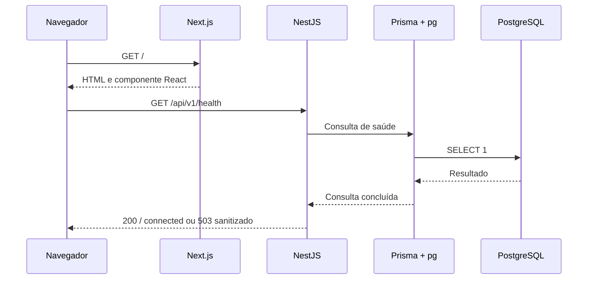

# Aplicações e testes

Escopo: S0-04/S0-05, RF-001/002/003/018, HU-01/02/10/12. [Arquitetura](architecture.md), [banco](database.md) e [ADR-008](decisions/ADR-008-apps-prisma-runtime.md).

## Versões e compatibilidade

| Componente                          | Versão fixada             | Verificação                                                                  |
| ----------------------------------- | ------------------------- | ---------------------------------------------------------------------------- |
| Node / pnpm / TypeScript            | 24.21.0 / 12.12.0 / 6.0.3 | Executáveis locais e compilação strict                                       |
| Next.js / React / React DOM         | 16.4.0 / 19.3.0 / 19.3.0  | Node >=20.9, peer React 19; build e browsers reais                           |
| Tailwind / plugin PostCSS           | 4.3.3 / 4.3.3             | CSS compilado no Next.js; sem download de fontes em build                    |
| NestJS common/core/platform-express | 12.1.2                    | Node >=20; CommonJS via require(esm) no Node 24                              |
| Prisma CLI / Client / adapter-pg    | 7.10.0                    | Node ^20.19, ^22.12 ou >=24; TypeScript >=5.4; geração/build/runtime         |
| pg                                  | 8.23.1                    | Node >=16; conexão e consultas reais                                         |
| ESLint / eslint-config-next         | 9.39.5 / 16.4.0           | Peers React 7.37.5 e JSX accessibility 6.10.2 ainda limitam ESLint à major 9 |
| typescript-eslint / Prettier        | 8.71.1 / 3.9.9            | TypeScript <6.1; lint e formatação executados                                |
| Playwright / tsx                    | 1.64.0 / 4.23.15          | Navegadores reais e execução de testes TypeScript                            |

Metadados npm e documentação oficial foram consultados em 11/10/2026: [Next.js](https://nextjs.org/docs/app/getting-started/installation), [React](https://react.dev/learn/creating-a-react-app), [Tailwind](https://tailwindcss.com/docs/installation/framework-guides/nextjs), [NestJS 12](https://docs.nestjs.com/migration-guide) e [Prisma/NestJS](https://docs.nestjs.com/recipes/prisma). O `latest` do CLI Prisma aponta para uma prévia 8: não é usado. CLI/client/adapter permanecem exatamente 7.10.0.

Dependências de execução estão no aplicativo que as usa; ferramentas compartilhadas ficam na raiz. A depreciação do ESLint 9 está registrada; atualizar sua major exige compatibilidade dos plugins e nova validação. Scripts de instalação de esbuild, unrs-resolver, Prisma e engines foram revisados e permitidos por versão em `pnpm-workspace.yaml`; não há autorização genérica para outros scripts.

## Ambiente e contratos

API e CLI Prisma procuram o `.env` privado na raiz do workspace. Variáveis já definidas no processo prevalecem. Zod valida URL PostgreSQL local, porta, host loopback e origens CORS exatas; erros não incluem valores privados. Não use o `.env` da raiz como ambiente do frontend.

O Next.js lê `apps/web/.env.local`; só `NEXT_PUBLIC_API_BASE_URL` é necessária. Variáveis `NEXT_PUBLIC_*` são públicas e incorporadas ao build do frontend: ao mudar a URL, reinicie o dev server ou refaça o build de produção. `DATABASE_URL` e `TEST_DATABASE_URL` nunca são importadas por componentes web.

`GET /api/v1/health` faz `SELECT 1` pelo Prisma a cada chamada, sem cache:

```json
{ "status": "ok", "service": "internradar-api", "database": { "status": "connected" } }
```

Se a consulta falha, retorna HTTP 503 com `code: DATABASE_UNAVAILABLE` e mensagem sanitizada. O endpoint não verifica versão de migrações ou quantidade de seeds. `/health` é um alias por redirecionamento 307. Rotas desconhecidas retornam JSON 404; erros inesperados não expõem SQL, stack ou credenciais. CORS permite somente as origens locais configuradas, com métodos GET/HEAD/OPTIONS e sem cookies.

A API pode iniciar com PostgreSQL temporariamente indisponível; a conexão é aberta sob demanda e a saúde retorna falha real. O driver limita conexão/consulta a três segundos; o frontend limita sua requisição a cinco segundos, cancela chamadas substituídas e permite nova tentativa.

## Fluxo de execução

O navegador recebe HTML/JavaScript do Next.js. O componente de conexão chama NestJS diretamente na URL pública configurada. NestJS valida o ambiente e usa `HealthService` → `PrismaService` → `PrismaPg`/`pg` → PostgreSQL. A interface só apresenta “Conexão verificada” após a resposta real de sucesso.



## Comandos e isolamento dos testes

- `pnpm dev`: inicia API/web com recarga; scripts individuais via `pnpm --filter @internradar/api dev` ou `@internradar/web`.
- `pnpm typecheck`: gera client Prisma/tipos Next e verifica ambas as aplicações sem emitir build.
- `pnpm build`: gera client e compila API; produz build otimizado Next.js.
- `pnpm test`: testes unitários de ambiente/conectores e HTTP da API, seguidos dos testes web Chromium/Firefox. Exige API/web compiladas e banco diário ativo; consultas de saúde são somente leitura; o runner web cria seu próprio schema no cluster de testes.
- `pnpm test:integration`: migração e persistência reais no cluster de testes. Valida nome/porta configurados e identificadores distintos dos clusters antes de escrever. Cada execução cria um schema `check_<uuid>` novo; dados/schemas são preservados e volumes não são recriados.
- `pnpm --filter @internradar/api db:migrate:status`: confirma migrações aplicadas.

Playwright usa os builds de produção e gerencia servidores próprios em 3100/3001, sem reutilizar processos existentes. Há conexão real nos testes de sucesso. Interceptações simulam falha de rede e o contrato HTTP 503 apenas para testar estados visuais; a falha real de conexão PostgreSQL é testada separadamente na API. O teste de persistência usa PostgreSQL real, sem mocks.

Preparação dos browsers: `pnpm --filter @internradar/web exec playwright install chromium firefox`. O ambiente WSL desta entrega já tinha bibliotecas de sistema suficientes. Em outro sistema, dependências nativas ausentes exigem preparação pelo operador; o projeto não instala pacotes globais automaticamente.

Relatórios/traces/screenshots e `next-env.d.ts` são gerados e ignorados. `next dev` escreve `apps/web/AGENTS.md`, mantido no Git. A [CI](ci.md) reutiliza os comandos com PostgreSQL/browsers no runner. O resultado remoto é conferido no PR; consulta real do Greenhouse não é executada pela pipeline.

Os testes de navegador usam a URL pública padrão `http://127.0.0.1:3001/api/v1` incorporada ao build. Se alterá-la para desenvolvimento, refaça o build com esse valor antes de executar a suíte. Os servidores de teste recusam portas já ocupadas.

`pnpm test:unit` não exige banco e inclui contratos/normalização/Greenhouse. `pnpm --filter @internradar/api test:http` executa somente HTTP real; essa separação evita testes duplicados na CI. [Conectores e demonstração](connectors.md).

## Vagas — S1-03/S1-04/S1-05

`/jobs` usa App Router com Suspense e componente cliente; filtros/paginação vivem na URL. Busca por formulário evita chamadas a cada tecla. Requisições substituídas são abortadas, timeout de cinco segundos, erro não é interpretado como vazio e links externos são validados. Conteúdo é texto React, nunca HTML executável. A rota inicial mantém a saúde e oferece acesso à listagem.

`GET /api/v1/jobs` valida queries com Zod e retorna erros 400 úteis/sanitizados. JobsModule não executa sincronização. CLI carrega apenas SyncModule, sem abrir porta HTTP. Os comandos e contrato estão em [synchronization.md](synchronization.md).

`pnpm --filter @internradar/web test` chama o runner no workspace API, onde já existem Prisma/pg/tsx. Ele verifica a identidade do cluster, migra um schema novo, executa vazio real em Chromium/Firefox, grava 23 anúncios sintéticos por SyncService e executa os demais testes com API real. Reutiliza os mesmos builds e schema nas duas fases, reiniciando apenas seus servidores Node. A API recebe DATABASE_URL de teste no processo; o ambiente privado diário não é editado. Execução direta de Playwright sem o runner é bloqueada para não consultar acidentalmente a base diária como fixture.

Testes de sucesso não interceptam a API. Falhas de rede/500/503 são simuladas apenas na interface; falhas PostgreSQL reais são exercitadas por testes de integração/HTTP. Relatórios são gerados e ignorados. Nenhum teste chama Greenhouse na CI.
