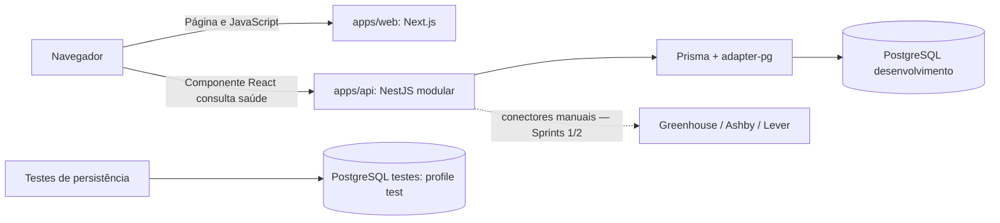

# Arquitetura do InternRadar

Referência: [especificação v1.0](requirements.md), preservada, e [decisões complementares](requirements-proposed-changes.md).

| Camada     | Responsabilidade                                        | Estado                 |
| ---------- | ------------------------------------------------------- | ---------------------- |
| Raiz       | Workspace, qualidade, infraestrutura e políticas comuns | Implementada           |
| Web        | Interface e cliente da API InternRadar                  | Aplicação executável   |
| API        | Configuração, saúde, domínio, conectores e persistência | Aplicação executável   |
| PostgreSQL | Dois clusters locais com armazenamento separado         | Homologado na S0-03    |
| Prisma     | Entidades, migrações e seed idempotente                 | Implementado e testado |
| CI         | Checks reais em PRs                                     | S0-06                  |

O backend terá fronteiras entre integração externa, normalização, serviços de domínio e persistência. Continuará um único aplicativo; adicionar uma plataforma não deve alterar a listagem pública de vagas. Saúde, configuração e persistência estão implementadas. Serviços de domínio, consulta de vagas e conectores pertencem às próximas sprints.

## Decisões

- [ADR-001: monorepo e backend modular](decisions/ADR-001-monorepo-e-monolito-modular.md).
- [ADR-002: PostgreSQL e Prisma](decisions/ADR-002-postgresql-prisma.md).
- [ADR-003: APIs públicas](decisions/ADR-003-coleta-por-apis-publicas.md).
- [ADR-006: ambientes](decisions/ADR-006-configuracao-de-ambientes.md).
- [ADR-007: GitHub Flow](decisions/ADR-007-versionamento-e-github-flow.md).
- [ADR-008: aplicações e runtime Prisma](decisions/ADR-008-apps-prisma-runtime.md).

Credenciais ficam na raiz privada; somente valores públicos permitidos chegam ao frontend. Dados externos são não confiáveis. O MVP começa local, com sincronização sob demanda e sem autenticação pública/deploy. Limitações e próximas validações constam no [acompanhamento](sprint-0.md).

A numeração ADR-004/005 permanece reservada aos contratos dos conectores e à política de datas/status previstos na seção 14.4 da especificação; serão documentados nas entregas correspondentes, sem antecipar implementação.

O fluxo real de saúde e os comandos estão em [applications.md](applications.md). Company → JobSource → Job/SyncRun foi implementado por migração; não há endpoints de negócio antecipados.
